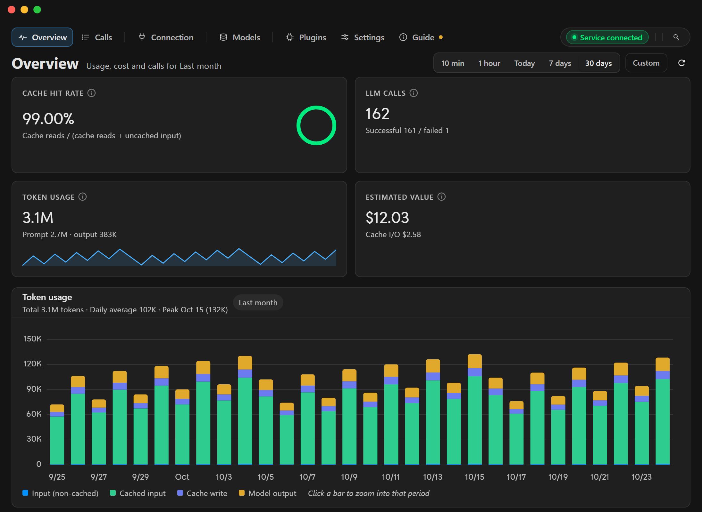
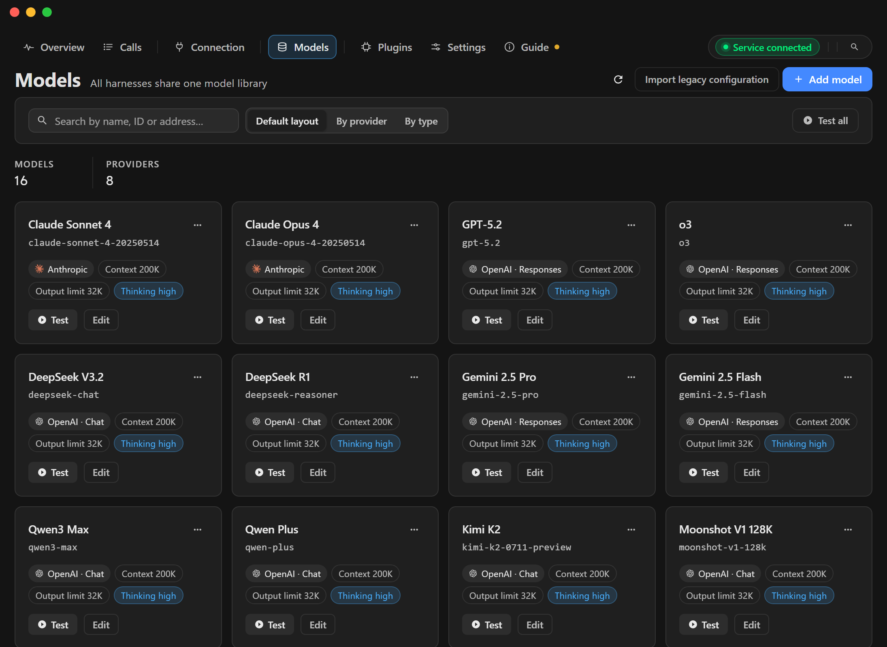

# haxsd byok

**Make Cursor, Devin, Codex and Claude Desktop use your own model API. Install it on Windows, keep your usual tools, and see every call and its estimated cost at a glance.**

[Download for Windows](https://github.com/haxsd/haxsd-byok/releases/latest) · [User guide](./docs/user-guide.md) · [Troubleshooting](./docs/troubleshooting.md) · English · [简体中文](./README.md) · [Русский](./README-RU.md)

## Why use it

- **Keep your workflow**: stay in Cursor, Devin, Codex and Claude Desktop; only model inference is replaced with the providers you configure (bring your own).
- **Own your models**: the model library supports OpenAI Chat / Responses and Anthropic protocols, with multi-select after discovery and a built-in connection test; in Cursor, official models and your own models can coexist.
- **See the cost**: every call's status, latency, token usage and an estimate from reference prices.
- **Desktop app**: Chinese, English and Russian, multiple themes, tray, in-app tutorial and signed updates.

## Supported clients

| Client | How it is taken over | Notes |
|---|---|---|
| Cursor | Official / local / mixed model sources + local proxy and local CA | Use local to route everything to your models, mixed to keep official models available too; local mode refuses models not in your library instead of silently going official. In local/mixed mode, long-session context compression (automatic and manual summaries) is done by this app's gateway; official mode is still compressed by Cursor |
| Devin | Optional local gateway + custom models and model mappings | Custom models appear in Devin’s native picker alongside its official catalog; structure-detected endpoint-settings patch with backup/restore and custom installation directories |
| Codex (ChatGPT client) | Local gateway + "Apply to Codex" | Keeps tools, terminal, approvals, sandbox and task loop; only inference is replaced, over Responses / Chat Completions / Anthropic; rewrites only managed fields in `config.toml` and restores them on undo |
| Claude Desktop | Local Anthropic gateway + a profile under `%LOCALAPPDATA%\Claude-3p\configLibrary` | Read-only with manual guidance when managed by an organisation policy |

All gateways are off by default and listen on `127.0.0.1` only. Managed settings, port changes and other details are in the [user guide](./docs/user-guide.md) and [Codex setup](./docs/codex-go-live.md).

### Capability boundaries

| Client | Available through local takeover | Still requires the official account or cloud |
| --- | --- | --- |
| Cursor | Agent / Chat / Plan, local subagents and tools, Rules / Skills / MCP, Checkpoint | Cloud Agents, Projects, Bugbot, Automations, Tab completion, CLI / IDE integrations, Remote Control |
| Codex | Local Agent / TUI / exec, Plan, tools, approvals, sandbox, multiple sessions, MCP / Skills / Plugins / Hooks, image input | ChatGPT Work, Codex Cloud, Remote Control, hosted web search / image generation / voice |
| Devin | Cascade, Devin Local, local tools, Rules / Memories / MCP, model mappings, Checkpoint | Account plans and quota, Tab / Command / embedding, Devin Cloud, remote indexing, Slack / Linear / Jira / Teams / GitHub integrations |
| Claude | Claude Desktop sessions, local tools, MCP / Skills / Hooks, Checkpoint, model-library routing | Cloud session, Teleport, Ultrareview, cloud schedules, Remote Control, provider-side WebSearch / WebFetch, cloud-account features |

Takeover changes only model requests that can be controlled locally. Sign-in, plans, quota and vendor cloud features still belong to each client and are not bypassed.

## Getting started

**Requirements:** Windows x64, and a model service you can use (an OpenAI Chat Completions / Responses or Anthropic-compatible endpoint).

1. Download the installer whose name contains `x64-setup.exe` from [Releases](https://github.com/haxsd/haxsd-byok/releases/latest) and install it.
2. On the **Models** page, add the base URL, API key and model ID, pick the protocol, and use **Test** to confirm it works.
3. **For Cursor**: initialize and trust the local CA, then pick the model source on the **Cursor** page. **Entering or leaving official mode stops a running Cursor: save your work and reopen it manually**; switching between local and mixed does not require a restart.
4. **For Devin**: add custom models to the native picker or map existing Devin models, then select a default, enable the gateway and save; set a custom installation directory under Advanced if needed. Restart the app, then follow [Devin setup](./docs/devin-go-live.md) to apply the integration and verify a request.
5. **For Codex**: pick models on the **Codex** page, enable the gateway and save, click **Apply to Codex**, then reopen the client or start a new session; see [Codex setup](./docs/codex-go-live.md).
6. **For Claude**: on the **Claude** page pick the default model, enable the gateway and save, then apply the Claude Desktop takeover; **quit Claude Desktop completely (including the tray) before applying, then start it again**.

Full steps for URLs, upgrades, backup and restore are in the [user guide](./docs/user-guide.md).

## Data, privacy and security

- API keys, settings and call records are stored in the local database at `%USERPROFILE%\.haxsd-byok-devin-v3`; custom-model requests go to your configured providers, while official-model and account requests still go to the corresponding official services. Cursor official mode writes no Cursor takeover configuration and records no official Cursor model calls.
- The local CA private key stays on this machine and is used for the Cursor local proxy. Treat backups as sensitive; never share API keys, the CA private key or the full database, or upload them to an issue.

## Compliance

- Claude subscription accounts ([notes](./docs/claude-account.md)) use subscription OAuth as a model source. That may violate Anthropic's terms and lead to rate limits or a ban, so prefer an Anthropic API key. The app does not impersonate any client and cannot guarantee the platform will not penalise you.
- This project is not affiliated with Cursor, Devin, OpenAI or Anthropic. Takeover modifies the client's local configuration, so please confirm and follow the terms of the target client and model provider.

## FAQ

- **Windows says "unknown publisher" or SmartScreen blocks the installer?** Updates are signed with this product's own Tauri update signature, which is not a Windows code signature. Choose **More info → Run anyway**; use the Releases page as the only distribution source.
- **How do I roll back?** Switch back to official mode and Cursor stops going through the local gateway; for Codex, undo "Apply to Codex" to restore the previous configuration; for Claude, undo the Claude Desktop takeover to remove the profile written by this app. Details are in the [user guide](./docs/user-guide.md).
- **How does this relate to cursor-byok?** This project is based on upstream [leookun/cursor-byok](https://github.com/leookun/cursor-byok); the author's personal repository `haxsd/cursor-byok` has been deleted.

## Build, support and license

See [development](./docs/development.md) for the toolchain, build and verification steps (common commands are in the root `Makefile`); third-party components and licenses are in [THIRD_PARTY_NOTICES.md](./THIRD_PARTY_NOTICES.md). Check [troubleshooting](./docs/troubleshooting.md) first, then open an [issue](https://github.com/haxsd/haxsd-byok/issues) with the version and steps (no keys, CA private key or database).

Based on [leookun/cursor-byok](https://github.com/leookun/cursor-byok), under the [MIT license](./LICENSE).
