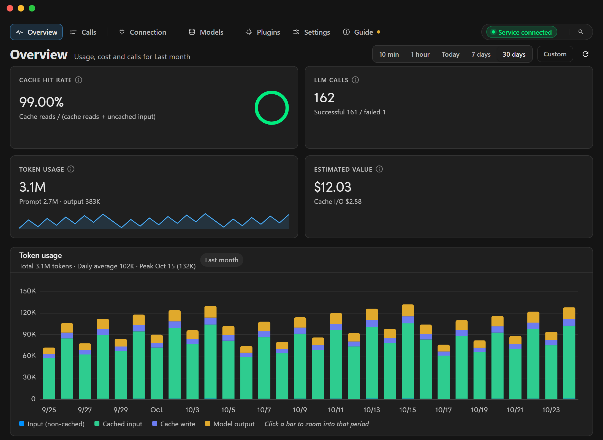
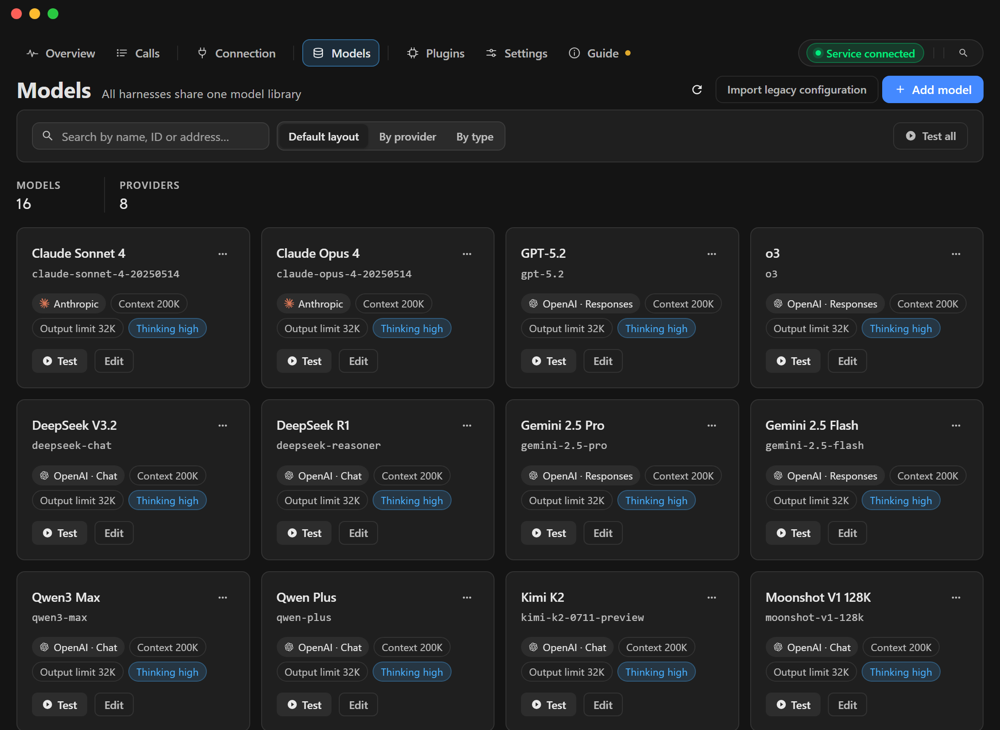

# haxsd byok

**Use your own models in Cursor, Devin, the Codex engine inside the ChatGPT client, Claude Code CLI and Claude Desktop: a local model gateway with a model library, takeover status and call records.**

[Download for Windows](https://github.com/haxsd/haxsd-byok/releases/latest) · [User guide](./docs/user-guide.md) · [Troubleshooting](./docs/troubleshooting.md) · English · [简体中文](./README.md) · [Русский](./README-RU.md)

## Why use it

- **Keep your workflow**: stay in Cursor, Devin, Codex, Claude Code CLI and Claude Desktop; only model inference is replaced with the providers you configure.
- **Own your models**: base URL, API key and model ID are stored on this machine. For Cursor you can pick official, local or mixed model sources, so official models and your own models can coexist.
- **See the cost**: every call's status, latency, token usage and an estimate from reference prices is recorded locally.

Model services are yours to provide. Keys and settings stay on this machine; requests go to the providers you configure.

## Features

| Capability | Details |
|---|---|
| Model library | Base URL, API key and model ID; OpenAI Chat / Responses and Anthropic protocols; built-in connection test |
| Cursor integration | Official, local or mixed model sources, with a local proxy, local CA and takeover status |
| Devin integration | Optional local gateway, model bindings and a host patch |
| Codex integration | The local Codex engine inside the ChatGPT client keeps its tools, terminal, approvals, sandbox and task loop; only model inference is replaced, over Responses / Chat Completions / Anthropic |
| Claude integration | A local Anthropic Messages gateway (`/v1/messages`) for Claude Code CLI and Claude Desktop; when Desktop is managed by an organisation policy, the app only shows manual setup guidance |
| Call insights | Success, latency and token usage, with an estimate based on reference prices |
| Desktop app | Chinese, English and Russian, multiple themes, tray, in-app tutorial and signed updates |

## Support matrix

| Client | How it is taken over | Notes |
|---|---|---|
| Cursor | Official / local / mixed model sources + local CA | **Enabling local or mixed mode stops a running Cursor, so save your work first.** Use local to route everything to your models; use mixed to keep official models available too. |
| Devin | Optional local gateway + model mappings | Off by default, listens on `127.0.0.1` only; after changing ports, restart the app and re-apply the host patch |
| Codex (ChatGPT client) | Local gateway + "Apply to Codex" | Keeps tools, terminal, approvals, sandbox and task loop; only inference is replaced. Off by default, listens on `127.0.0.1` only |
| Claude Code CLI | Local Anthropic gateway + writes the `env` block of `~/.claude/settings.json` | Off by default, listens on `127.0.0.1` only. Reopen Claude Code after applying. Refuses to overwrite an existing Anthropic API key, Bedrock/Vertex/Foundry setup or `apiKeyHelper`; with `managed-settings.json` or a registry policy it reports "managed" and stays read-only |
| Claude Desktop | Local Anthropic gateway + writes a profile under `%LOCALAPPDATA%\Claude-3p\configLibrary` | **Quit Claude Desktop completely (including the tray) before applying, then start it again.** With an organisation policy (HKLM/HKCU) the app is read-only and only shows manual guidance |

## Getting started

**Requirements:** Windows x64, and a model service you can use (an OpenAI Chat Completions / Responses or Anthropic-compatible endpoint).

1. Download the installer whose name contains `x64-setup.exe` from [Releases](https://github.com/haxsd/haxsd-byok/releases/latest) and install it.
2. On the **Models** page, add the base URL, API key and model ID, pick the protocol, and use **Test** to confirm it works.
3. **For Cursor**: initialize the local CA and trust it, then pick the model source on the **Cursor** page. Enabling local or mixed mode stops a running Cursor, so save your work first.
4. **For Devin**: set up model mappings, enable the gateway and save, restart the app, then follow [Devin setup](./docs/devin-go-live.md).
5. **For Codex**: pick models on the **Codex** page, enable the gateway and save, click **Apply to Codex**, then reopen the client or start a new session; see [Codex setup](./docs/codex-go-live.md).
6. **For Claude**: on the **Claude** page pick the default model, enable the gateway and save, then apply the takeover per client: reopen Claude Code after applying for the CLI; for Claude Desktop, quit it completely (including the tray), apply, then start it again. See the [user guide](./docs/user-guide.md).

Full steps for URLs, upgrades, backup and restore are in the [user guide](./docs/user-guide.md).

## Data, privacy and security

- Keys, settings and call records live in the local database at `%USERPROFILE%\.haxsd-byok-devin-v3`.
- Model requests go to the providers you configure; keys, settings and call records stay on this machine.
- The local CA private key stays on this machine and is used for the Cursor local proxy; never share it or the full database.
- Treat backups as sensitive files. Do not upload API keys, the CA private key or the full database to an issue.

## Boundaries and compliance

- Local and mixed modes rewrite Cursor's proxy configuration, so restart Cursor when switching modes. Official mode writes nothing and records nothing.
- Local mode only knows the models in your library; anything else is refused instead of silently going official.
- Devin and Codex integrations are off by default and listen on `127.0.0.1` only. The Codex integration rewrites only the managed fields in that client's `config.toml` and restores them when you undo; it does not touch login, MCP, skills or approval settings.
- Claude subscription accounts ([notes](./docs/claude-account.md)) use subscription OAuth as a model source. That may violate Anthropic's terms and lead to rate limits or a ban, so prefer an Anthropic API key. The app does not impersonate any client and cannot guarantee the platform will not penalise you.
- This product keeps separate data, identifiers and update channels from [haxsd/cursor-byok](https://github.com/haxsd/cursor-byok); the two do not interfere.
- This project is not affiliated with Cursor, Devin, OpenAI or Anthropic. Takeover modifies the client's local configuration, so please confirm and follow the terms of the target client and model provider.

## FAQ

- **Windows says "unknown publisher" or SmartScreen blocks the installer?** Updates are signed with this product's own Tauri update signature, which is not a Windows code signature. Choose **More info → Run anyway**; use the Releases page as the only distribution source.
- **Which models are supported?** Any service compatible with the OpenAI Chat Completions / Responses or Anthropic protocols — you provide the URL, key and model ID.
- **Does it upload my keys or call records?** Keys, settings and call records stay on this machine; requests only go to the model providers you configure.
- **How do I roll back?** Switch back to official mode and Cursor stops going through the local gateway; on the Codex side, undo "Apply to Codex" to restore the previous configuration; for Claude, undo the takeover on the matching tab to remove the keys written to `settings.json` or the Desktop profile. Details are in the [user guide](./docs/user-guide.md).
- **How does this relate to cursor-byok?** Two independent products by the same author with different data directories, identifiers and update channels; this project rebuilds on that base, see [UPSTREAM.md](./UPSTREAM.md).

## Build from source and contribute

See [development](./docs/development.md) for the toolchain, build and verification steps; the root `Makefile` collects the common commands. Third-party components and licenses are listed in [THIRD_PARTY_NOTICES.md](./THIRD_PARTY_NOTICES.md).

## Support and license

Check [troubleshooting](./docs/troubleshooting.md) first, then open an [issue](https://github.com/haxsd/haxsd-byok/issues). Include the version and the steps; never upload API keys, the CA private key or a full database.

Based on [leookun/cursor-byok](https://github.com/leookun/cursor-byok), under the [MIT license](./LICENSE).
