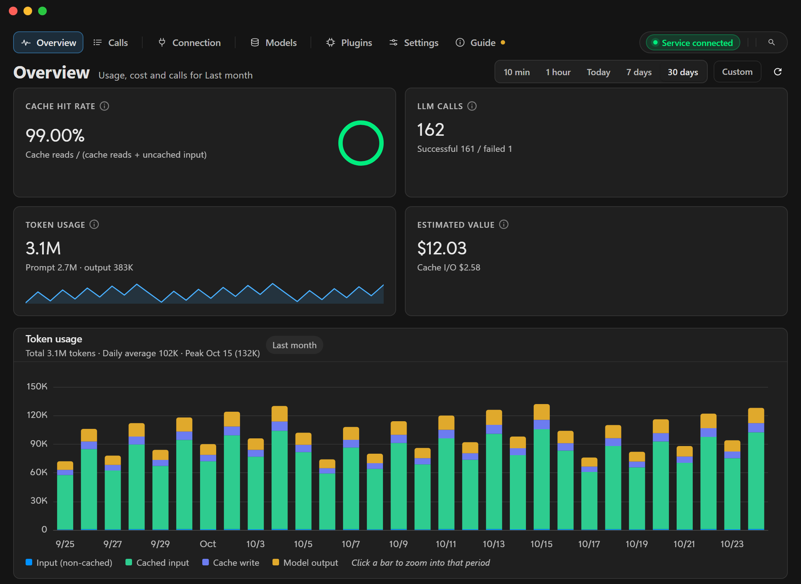
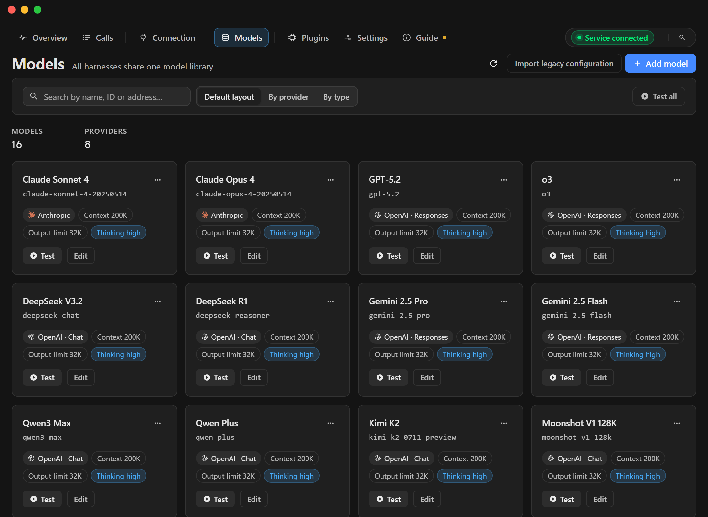

# haxsd byok

**Используйте собственные модели в Cursor, Devin, Codex внутри клиента ChatGPT, а также в Claude Code CLI и Claude Desktop: локальный шлюз моделей с библиотекой моделей, статусом перехвата и журналом вызовов.**

[Скачать для Windows](https://github.com/haxsd/haxsd-byok/releases/latest) · [Руководство пользователя](./docs/user-guide.md) · [Устранение неполадок](./docs/troubleshooting.md) · Русский · [简体中文](./README.md) · [English](./README-EN.md)

## Зачем это нужно

- **Не менять рабочий процесс**: оставайтесь в привычном интерфейсе Cursor, Devin, Codex, Claude Code CLI и Claude Desktop — на настроенный вами сервис (его нужно подготовить самостоятельно) заменяется только инференс модели.
- **Модели под вашим управлением**: библиотека моделей поддерживает протоколы OpenAI Chat / Responses и Anthropic, множественный выбор после обнаружения и встроенную проверку подключения; в Cursor официальные и собственные модели могут работать одновременно.
- **Расходы на виду**: успех или ошибка, задержка, расход Token и оценка стоимости по справочным ценам для каждого вызова.
- **Настольное приложение**: интерфейс на китайском, английском и русском, несколько тем, значок в трее, встроенное обучение и подписанные обновления.

## Поддерживаемые клиенты

| Клиент | Способ перехвата | Примечания |
|---|---|---|
| Cursor | Официальный / локальный / смешанный источник моделей + локальный прокси и локальный CA | Только собственные модели — локальный режим, официальные тоже доступны — смешанный; в локальном режиме модели не из библиотеки явно отклоняются, а не уходят молча к официальной. В локальном/смешанном режиме сжатие контекста длинных сеансов (автоматические и ручные сводки) выполняет шлюз приложения; в официальном режиме — сам Cursor |
| Devin | Необязательный локальный шлюз + собственные модели и сопоставления | Собственные модели появляются в штатном списке Devin рядом с официальным каталогом; патч определяется по структуре настроек конечных точек, с резервной копией, восстановлением и нестандартным каталогом установки |
| Codex (клиент ChatGPT) | Локальный шлюз + «Применить к Codex» | Сохраняет инструменты, терминал, подтверждения, песочницу и цикл задач, заменяет только инференс; Responses / Chat Completions / Anthropic; меняет только управляемые поля `config.toml` и восстанавливает их при отмене |
| Claude Code CLI | Локальный шлюз Anthropic (`/v1/messages`) + блок `env` в `~/.claude/settings.json` | Не перезаписывает существующий Anthropic API Key, настройки Bedrock/Vertex/Foundry, `apiKeyHelper` или управляемую конфигурацию |
| Claude Desktop | Локальный шлюз Anthropic + профиль в `%LOCALAPPDATA%\Claude-3p\configLibrary` | При политике организации — только чтение и руководство по ручной настройке |

Все шлюзы по умолчанию выключены и слушают только `127.0.0.1`. Управляемая конфигурация, смена порта и другие подробности — в [руководстве пользователя](./docs/user-guide.md) и [Подключение Codex](./docs/codex-go-live.md) (пока только на китайском).

### Границы возможностей

| Клиент | Доступно через локальный перехват | По-прежнему требует официальной учётной записи или облака |
| --- | --- | --- |
| Cursor | Agent / Chat / Plan, локальные субагенты и инструменты, Rules / Skills / MCP, Checkpoint | Cloud Agents, Projects, Bugbot, Automations, автодополнение Tab, интеграции CLI / IDE, Remote Control |
| Codex | Локальные Agent / TUI / exec, Plan, инструменты, подтверждения, песочница, несколько сеансов, MCP / Skills / Plugins / Hooks, ввод изображений | ChatGPT Work, Codex Cloud, Remote Control, облачные веб-поиск / генерация изображений / голос |
| Devin | Cascade, Devin Local, локальные инструменты, Rules / Memories / MCP, сопоставление моделей, Checkpoint | Тариф и лимиты, Tab / Command / embedding, Devin Cloud, удалённая индексация, интеграции Slack / Linear / Jira / Teams / GitHub |
| Claude | Claude Code CLI, локальные субагенты и фоновые сеансы, MCP / Skills / Hooks, Checkpoint / Rewind / автосжатие, локальная интеграция с IDE | Cloud session, Teleport, Ultrareview, облачные расписания, Remote Control, WebSearch / WebFetch на стороне провайдера, передача из CLI в Desktop |

Перехват меняет только те запросы моделей, которые можно контролировать локально. Вход, тарифы, лимиты и облачные функции по-прежнему принадлежат клиенту и не обходятся.

## Быстрый старт

**Требования**: Windows x64 и доступный модельный сервис (совместимый с OpenAI Chat Completions / Responses или Anthropic).

1. Скачайте со страницы [Releases](https://github.com/haxsd/haxsd-byok/releases/latest) установщик, в имени которого есть `x64-setup.exe`, и установите его.
2. На странице «Модели» добавьте адрес, API Key и ID модели, выберите протокол и нажмите «Тест», чтобы убедиться, что подключение работает.
3. **Для Cursor**: инициализируйте локальный CA и доверьтесь сертификату, затем выберите источник моделей на странице «Cursor». **Вход в официальный режим и выход из него завершают работу Cursor: сначала сохраните работу, затем откройте его вручную**; переключение между локальным и смешанным режимами не требует перезапуска.
4. **Для Devin**: добавьте собственные модели в штатный список или сопоставьте существующие модели Devin, затем выберите модель по умолчанию, включите шлюз и сохраните; нестандартный каталог установки задаётся в разделе «Дополнительно». Перезапустите приложение, затем примените интеграцию и проверьте запрос по инструкции [Подключение Devin](./docs/devin-go-live.md).
5. **Для Codex**: на странице «Codex» выберите модели, включите шлюз и сохраните, нажмите «Применить к Codex», затем откройте клиент заново или создайте новую сессию; подробнее — [Подключение Codex](./docs/codex-go-live.md).
6. **Для Claude**: на странице «Claude» выберите модель по умолчанию, включите шлюз и сохраните, затем примените перехват для нужного клиента: для CLI заново откройте Claude Code; **Claude Desktop перед применением полностью закройте (включая значок в трее), затем запустите снова**.

Полные шаги по указанию адреса, обновлению, резервному копированию и восстановлению — в [руководстве пользователя](./docs/user-guide.md). Документация пока доступна только на китайском языке.

## Данные, конфиденциальность и безопасность

- API Key, настройки и журнал вызовов хранятся в локальной базе данных `%USERPROFILE%\.haxsd-byok-devin-v3`; запросы собственных моделей идут настроенным провайдерам, а запросы официальных моделей и учётных записей — соответствующим официальным сервисам. Официальный режим Cursor не записывает конфигурацию его перехвата и не журналирует вызовы официальных моделей Cursor.
- Закрытый ключ локального CA хранится только на этом компьютере и используется локальным прокси для Cursor. Считайте резервные копии конфиденциальными: не передавайте API Key, закрытый ключ CA или всю базу данных другим и не прикладывайте их к Issue.

## Соответствие требованиям

- Подключение подписки Claude ([описание](./docs/claude-account.md)) использует OAuth подписки как источник моделей: это может нарушать условия Anthropic и привести к ограничениям или блокировке аккаунта, поэтому предпочтителен Anthropic API Key. Приложение не выдаёт себя за клиентов Anthropic и не может гарантировать, что платформа не применит санкции.
- Проект не связан с Cursor, Devin, OpenAI, Anthropic и другими вендорами. Перехват изменяет локальную конфигурацию клиента, поэтому самостоятельно проверьте и соблюдайте условия целевого клиента и провайдера моделей.

## Частые вопросы

- **Windows сообщает о неизвестном издателе или SmartScreen блокирует установку?** Обновления подписаны собственной подписью Tauri этого продукта, которая не заменяет подпись кода Windows. Выберите «Подробнее → Выполнить в любом случае»; официальная сборка распространяется только со страницы Releases.
- **Как откатиться?** Переключитесь обратно в официальный режим, и Cursor перестанет работать через локальный шлюз; для Codex отмените «Применить к Codex», чтобы вернуть прежнюю конфигурацию; для Claude отмените перехват на нужной вкладке — это удалит ключи из `settings.json` или профиль Claude Desktop. Подробнее — в [руководстве пользователя](./docs/user-guide.md).
- **Как проект связан с cursor-byok?** Проект основан на upstream [leookun/cursor-byok](https://github.com/leookun/cursor-byok); личный репозиторий автора `haxsd/cursor-byok` удалён.

## Сборка, обратная связь и лицензия

Окружение разработки, сборка и проверка описаны в [документации для разработчиков](./docs/development.md) (основные команды — в `Makefile` в корне); сторонние компоненты и лицензии — в [THIRD_PARTY_NOTICES.md](./THIRD_PARTY_NOTICES.md). Если что-то не работает, сначала загляните в [«Устранение неполадок»](./docs/troubleshooting.md), затем создайте [Issue](https://github.com/haxsd/haxsd-byok/issues) с версией и шагами (без ключей, закрытого ключа CA и базы данных).

Проект основан на [leookun/cursor-byok](https://github.com/leookun/cursor-byok) и распространяется по [лицензии MIT](./LICENSE).
