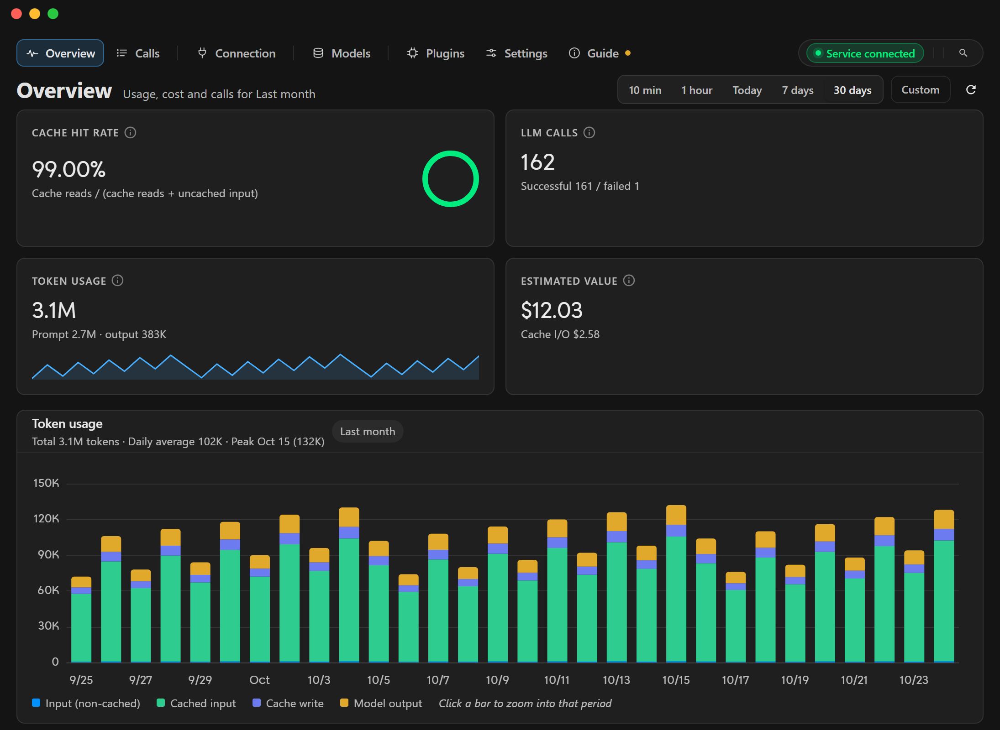
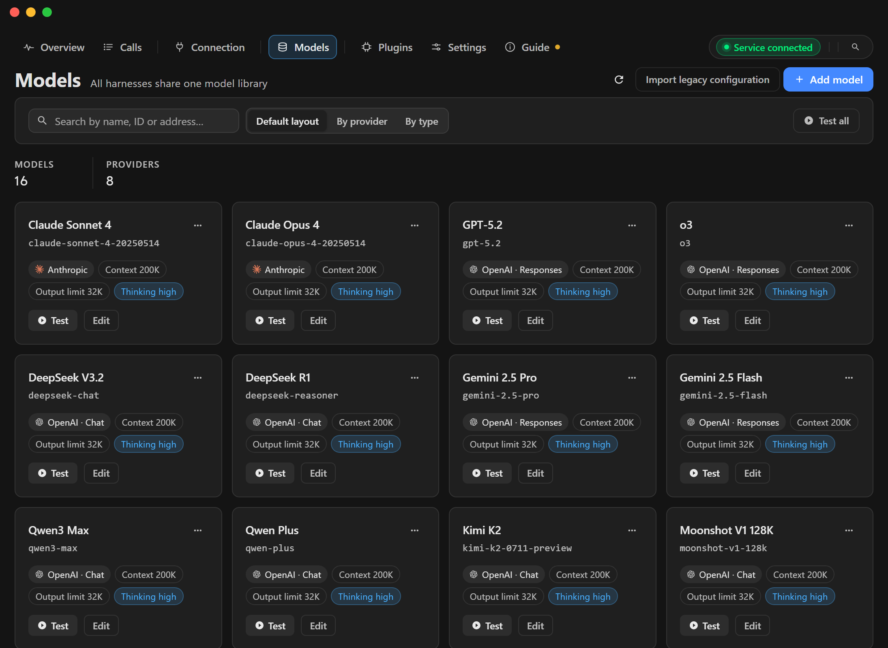

# haxsd byok

**在 Cursor、Devin、ChatGPT 客户端里的 Codex，以及 Claude Code CLI 与 Claude Desktop 中使用你自己配置的模型：本地模型网关，自带模型库、接管状态和调用记录。**

[下载 Windows 安装包](https://github.com/haxsd/haxsd-byok/releases/latest) · [用户指南](./docs/user-guide.md) · [故障排查](./docs/troubleshooting.md) · 简体中文 · [English](./README-EN.md) · [Русский](./README-RU.md)

## 为什么用它

- **不换工作流**：继续用 Cursor、Devin、Codex、Claude Code CLI 与 Claude Desktop 的界面和习惯，只把模型推理换成你配置的服务（需自备）。
- **模型自己管**：模型库支持 OpenAI Chat / Responses 与 Anthropic 协议，发现后多选添加、带连接测试；Cursor 可让官方模型和自配模型同时可用。
- **成本看得见**：每次调用的成败、耗时、Token 用量，以及按参考单价估算的金额。
- **桌面管理**：中英俄三语、多主题、托盘、应用内教程与签名更新。

## 支持的客户端

| 客户端 | 接管方式 | 说明 |
|---|---|---|
| Cursor | 官方 / 本地 / 混合模型来源 + 本机代理与本地 CA | 只用自配模型选本地，官方模型同时可用选混合；本地模式不在模型库的模型会被明确拒绝，不会静默走官方。本地/混合模式下长会话的上下文压缩（自动与手动摘要）由本应用网关执行，官方模式仍由 Cursor 自己压缩 |
| Devin | 可选本机网关 + 自选模型与模型映射 | 自选模型直接出现在 Devin 原生选择器；保留官方目录；按端点设置结构识别的补丁，带备份恢复与自定义安装目录 |
| Codex（ChatGPT 客户端） | 本机网关 + “应用到 Codex” | 保留工具、终端、审批、沙箱与任务循环，只替换推理；支持 Responses / Chat Completions / Anthropic；只改 `config.toml` 受管字段，撤销即恢复 |
| Claude Code CLI | 本机 Anthropic 网关（`/v1/messages`）+ 写入 `~/.claude/settings.json` 的 `env` | 已有 Anthropic API Key、Bedrock/Vertex/Foundry、`apiKeyHelper` 或受管配置时不覆盖 |
| Claude Desktop | 本机 Anthropic 网关 + `%LOCALAPPDATA%\Claude-3p\configLibrary` 下的 profile | 组织策略托管时只读，只给手工配置引导 |

各网关默认关闭，只监听 `127.0.0.1`。受管配置、端口修改等细节见 [用户指南](./docs/user-guide.md) 与 [Codex 接入](./docs/codex-go-live.md)。

### 能力边界

| 客户端 | 本机接管可用 | 仍需官方账号或云端 |
| --- | --- | --- |
| Cursor | Agent / Chat / Plan、本机子代理与工具、Rules / Skills / MCP、Checkpoint | Cloud Agents、Projects、Bugbot、Automations、Tab 补全、CLI / IDE 插件、Remote Control |
| Codex | 本地 Agent / TUI / exec、Plan、工具、审批、沙箱、多会话、MCP / Skills / Plugins / Hooks、图片输入 | ChatGPT Work、Codex Cloud、Remote Control、官方托管搜索 / 图像 / 语音 |
| Devin | Cascade、Devin Local、本机工具、Rules / Memories / MCP、模型映射、Checkpoint | 账号套餐与额度、Tab / Command / embedding、Devin Cloud、远程索引、Slack / Linear / Jira / Teams / GitHub 集成 |
| Claude | Claude Code CLI、本机子代理与后台会话、MCP / Skills / Hooks、Checkpoint / Rewind / 自动压缩、本机 IDE 集成 | Cloud session、Teleport、Ultrareview、云端定时任务、Remote Control、供应商侧 WebSearch / WebFetch、CLI 到 Desktop 的 handoff |

接管只改变本机可控制的模型请求；登录、套餐、额度和厂商云端功能仍由对应客户端管理，不会绕过。

## 快速开始

**系统要求**：Windows x64；一个可用的模型服务（OpenAI Chat Completions / Responses 或 Anthropic 兼容接口）。

1. 从 [Releases](https://github.com/haxsd/haxsd-byok/releases/latest) 下载名称含 `x64-setup.exe` 的安装包并安装。
2. 在「模型」页添加地址、API Key 与模型 ID，选择协议，用「测试」确认可用。
3. **用 Cursor**：初始化本地 CA 并按提示信任，再到「Cursor」页选择模型来源。**进出官方模式会结束正在运行的 Cursor，先保存工作并手动重新打开**；本地与混合模式之间切换不需要重启。
4. **用 Devin**：添加自选模型（直接出现在原生选择器）或映射已有 Devin 模型，再选默认模型、启用网关并保存；自定义安装目录在「高级」填写。重启应用后按 [Devin 接入](./docs/devin-go-live.md) 写入接入配置并验证。
5. **用 Codex**：在「Codex」页选择模型、启用网关并保存，点「应用到 Codex」，然后重新打开客户端或新建会话；详见 [Codex 接入](./docs/codex-go-live.md)。
6. **用 Claude**：在「Claude」页选择默认模型、启用网关并保存，再按客户端应用接管：CLI 应用后重新打开 Claude Code；**Desktop 需先完全退出（含托盘），应用后再启动**。

地址填写、升级、备份与恢复的完整步骤见 [用户指南](./docs/user-guide.md)。

## 数据、隐私与安全

- API Key、设置与调用记录保存在本机数据库 `%USERPROFILE%\.haxsd-byok-devin-v3`；自配模型请求发往你配置的服务商，官方模型与账号相关请求仍发往对应官方服务。Cursor 官方模式不写 Cursor 接管配置，也不记录其官方模型调用。
- 本地 CA 私钥只在本机，用于 Cursor 本地代理。备份按敏感文件保管，不要把 API Key、CA 私钥或整个数据库发给别人或上传到 Issue。

## 合规

- Claude 订阅账号接入（[说明](./docs/claude-account.md)）用订阅 OAuth 作为模型来源，可能违反 Anthropic 的条款并导致限流或封号；优先使用 Anthropic API Key。本应用不伪装客户端，也无法保证平台不处罚。
- 本项目与 Cursor、Devin、OpenAI、Anthropic 等厂商无隶属关系。接入会改写客户端本地配置，请自行确认并遵守目标客户端与模型服务商的条款。

## 常见问题

- **Windows 提示“未知发布者”或 SmartScreen 拦截？** 更新包使用本产品自己的 Tauri 更新签名，不等同于 Windows 代码签名。选择「更多信息 → 仍要运行」即可；正式分发版本以 Releases 页为准。
- **怎么回滚？** 切回官方模式后 Cursor 不再经过本地网关；Codex 侧撤销“应用到 Codex”恢复原配置；Claude 侧在对应标签页撤销接管，移除写入 `settings.json` 的键或 Desktop 的 profile。详见 [用户指南](./docs/user-guide.md)。
- **和 cursor-byok 是什么关系？** 同一作者的两个独立产品，数据目录、标识和更新渠道都不同，互不影响；本项目在其基础上重做，见 [UPSTREAM.md](./UPSTREAM.md)。

## 构建、反馈与许可

开发环境、构建与验证见 [开发说明](./docs/development.md)（常用命令在根目录 `Makefile`）；第三方组件与许可见 [THIRD_PARTY_NOTICES.md](./THIRD_PARTY_NOTICES.md)。遇到问题先看 [故障排查](./docs/troubleshooting.md)，再提 [Issue](https://github.com/haxsd/haxsd-byok/issues)，附上版本与出错步骤（勿附 Key、CA 私钥或数据库）。

基于 [leookun/cursor-byok](https://github.com/leookun/cursor-byok)，沿用 [MIT 许可证](./LICENSE)。
